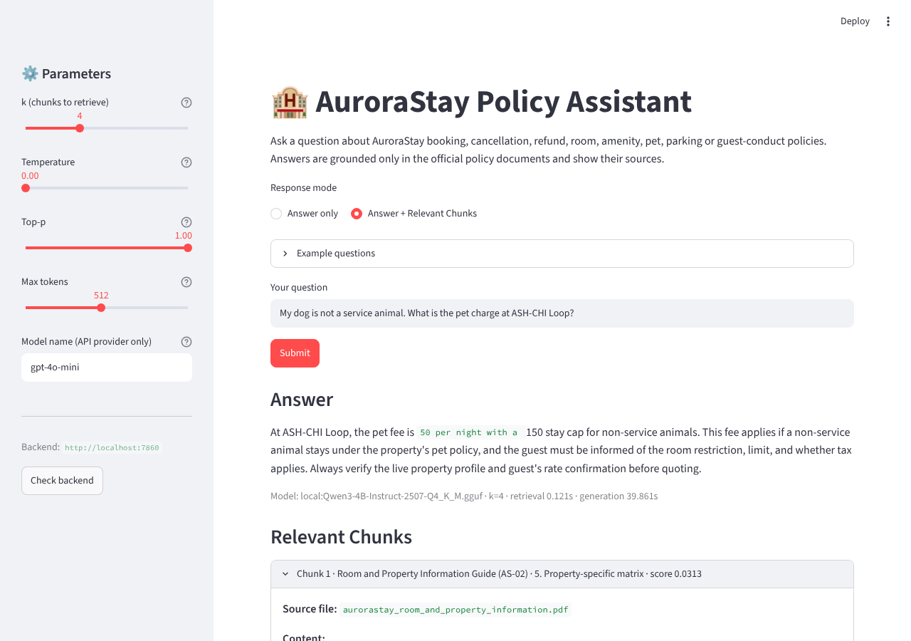

# AuroraStay Hotels – Policy Query Assistant (RAG POC)

A Retrieval-Augmented Generation proof of concept that lets AuroraStay hotel staff ask
natural-language questions and receive answers grounded **only** in the group's four
official policy documents, with the supporting source excerpts shown next to every answer.

| Folder / file | What it is |
|---|---|
| `AuroraStay_RAG_POC.ipynb` / `.html` | Full-code notebook: data understanding → chunking → embeddings + FAISS → grounded generation → DeepEval evaluation → deployment files → online inference → insights & recommendations. **The `.html` export is the submission artefact.** |
| `data/` | The four policy PDFs plus `evaluation.csv` (10 benchmark queries) and `test.xlsx` (10 test queries). |
| `backend/` | Flask REST API (`app.py`), the RAG pipeline (`rag_utils.py`), the serialized FAISS index (`faiss_index/`), pinned `requirements.txt`, `Dockerfile`. |
| `frontend/` | Streamlit UI for staff (`app.py`), `requirements.txt`, `Dockerfile`. |

## Architecture

```
PDF policies ──pymupdf4llm──▶ markdown ──section-aware chunker──▶ 39 chunks
      ──BAAI/bge-small-en-v1.5──▶ FAISS index (serialized to backend/faiss_index)

Staff question ──▶ Streamlit (8501) ──HTTP──▶ Flask (7860)
                         ▲                     │ retrieve top-k chunks
                         │                     │ grounded prompt → LLM
                         └──── answer + cited chunks ◀──┘
```

LLM provider is selected at runtime: an OpenAI-compatible endpoint when
`OPENAI_API_KEY` (and optionally `OPENAI_API_BASE`) is set, otherwise a local
open-weights model (`Qwen3-4B-Instruct-2507`, GGUF via llama.cpp) so the whole
system also runs with no API key at all.

## Run locally with Docker

```bash
cd aurorastay-rag/backend
docker build -t aurora-backend .
docker run --name backend --network host \
  -e OPENAI_API_KEY="$OPENAI_API_KEY" -e OPENAI_API_BASE="$OPENAI_API_BASE" aurora-backend
```

```bash
cd aurorastay-rag/frontend
docker build -t aurora-frontend .
docker run --name frontend --network host aurora-frontend
```

Open http://localhost:8501. Without an API key, omit the `-e` flags and the backend
downloads the local model on first start (about 2.5 GB).

## Deploy with GitHub Codespaces

1. Add `OPENAI_API_KEY` and `OPENAI_API_BASE` as Codespaces secrets with access to this repository.
2. Create a Codespace on this branch, then run the four Docker commands above from
   `aurorastay-rag/backend` and `aurorastay-rag/frontend`.
3. In the **Ports** tab set ports 7860 and 8501 to **Public**. The forwarded 7860 URL is the
   backend URL used in the notebook's *Deployment – Inference* section; the 8501 URL is the staff UI.
4. Delete the Codespace when done to stop consuming quota.

## API

| Endpoint | Body | Returns |
|---|---|---|
| `GET /health` | – | status, models, chunk count |
| `POST /v1/relevant_chunks` | `{query, k}` | top-k chunks with scores and sources |
| `POST /v1/answer` | `{query, k, model_name, temperature, top_p, max_tokens}` | grounded answer |
| `POST /v1/answer_with_relevant_chunks` | same | answer + chunks |

## Results (gpt-4o-mini generator and judge, DeepEval metrics, threshold 0.7)

| Metric | Evaluation set (10) | Test set (10) | Pass rate, all 20 |
|---|---|---|---|
| Faithfulness | 0.94 | 0.97 | 80% |
| Answer Relevancy | 0.87 | 0.88 | 65% |
| Contextual Precision | 0.78 | 0.93 | 85% |
| Contextual Recall | 0.83 | 0.77 | 65% |
| **Composite** | **0.85** | **0.89** | **8/20 pass all four** |

Retrieval benchmark (20 labelled questions, k = 4, hybrid dense + BM25 with `bge-small-en-v1.5`):
context recall 0.77, hit rate 0.95. Full tables and the judge's reasons are in `results/`.

## Screenshot



## Reproducing the notebook

Python 3.12+ with: `pymupdf4llm pymupdf sentence-transformers faiss-cpu langchain-community langchain-huggingface
langchain-text-splitters rank_bm25 openai deepeval pandas matplotlib openpyxl jupyter` (plus `llama-cpp-python` and
`huggingface_hub` for the local-model fallback). Environment variables:

| Variable | Purpose |
|---|---|
| `OPENAI_API_KEY`, `OPENAI_API_BASE` | Use an OpenAI-compatible endpoint for generation and judging (`LLM_MODEL` selects the model id, default `gpt-4o-mini`). Without a key the local GGUF model is used. |
| `LOCAL_LLM_PATH` | Reuse an already-downloaded GGUF file instead of fetching it from the Hugging Face Hub. |
| `EVAL_USE_CACHE` | `1` (default) reuses answers and judge scores saved in `results/` for matching questions; `0` re-judges everything. |
| `BACKEND_URL` | Backend address for the frontend and the notebook's inference cells (default `http://localhost:7860`; in Codespaces the forwarded `https://<name>-7860.app.github.dev`). |
| `BACKEND_TIMEOUT` | Frontend request timeout in seconds (default 600, matching the backend's gunicorn timeout). |

Other folders: `docs/` holds the UI screenshot, `results/` the retrieval benchmark, generated answers and DeepEval
scores with the judge's reasons. Branch: `claude/aurorastay-query-assistant-poc-p9itjs`.
